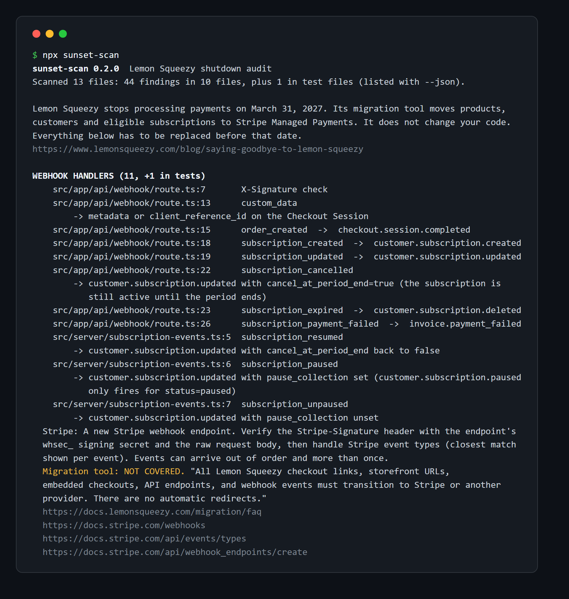

# sunset-scan

**Find every place your code depends on Lemon Squeezy before it stops processing payments.**

Lemon Squeezy [stops processing payments on March 31, 2027](https://www.lemonsqueezy.com/blog/saying-goodbye-to-lemon-squeezy), and the deadline will not be extended. Its [migration tool](https://docs.lemonsqueezy.com/migration) moves your products, customers and eligible subscriptions to Stripe Managed Payments. It does not touch your code: checkout links, API calls, webhooks, portal links and licence-key checks all have to be replaced by you, and [none of them redirect automatically](https://docs.lemonsqueezy.com/migration/faq).

`sunset-scan` reads a JavaScript or TypeScript project and lists those places with file and line, the closest Stripe equivalent for each, and whether Lemon Squeezy's migration tool covers it.



```sh
npx sunset-scan            # scan the current folder
npx sunset-scan ./my-app   # scan another folder
npx sunset-scan --json     # machine-readable report
npx sunset-scan --markdown > lemon-squeezy-exit.md   # checklist to track the move
```

It only reads files. It never changes the scanned project, makes no network calls, and reports environment variable names, never their values.

## What it finds

| Area | What is matched |
|---|---|
| SDK | `@lemonsqueezy/lemonsqueezy.js` (current and v1 client) and `lemonsqueezy.ts`: imports and every call, grouped into checkout, subscriptions, customers, licence keys, usage records, orders, discounts, files and webhooks |
| Direct API | `api.lemonsqueezy.com/v1/...` URLs, including licence `activate` / `validate` / `deactivate`, and path fragments built from a base URL |
| Checkout | `*.lemonsqueezy.com/checkout/...` and `/buy/...` links, `lemon.js`, `lemonsqueezy-button`, `LemonSqueezy.Url.Open` and the other Lemon.js calls |
| Customer portal | `*.lemonsqueezy.com/billing` links and `urls.customer_portal` / `urls.update_payment_method` |
| Webhooks | the `X-Signature` check, `custom_data`, and every Lemon Squeezy event name handled (17 events), each with its closest Stripe event |
| Stored IDs | Lemon Squeezy customer, subscription and variant ID columns in Prisma schemas, SQL and model files |
| Affiliates and hosted files | `lmsqueezy.com/affiliate.js`, `LemonSqueezy.Affiliate.*`, images on `lemonsqueezy.imgix.net` |
| Configuration | environment variables such as `LEMONSQUEEZY_API_KEY` or `NEXT_PUBLIC_LS_..._VARIANT_ID` in `.env*` files, code and CI config, with the Stripe value that replaces each |

Every finding carries one of three migration-tool labels, taken from Lemon Squeezy's migration docs:

- **NOT COVERED**: the docs say it is not moved, not included or not redirected (code, links, webhooks, portal, licence keys, files, affiliates).
- **DATA ONLY**: the tool moves the records (customers, products, eligible subscriptions), but IDs change and your code still has to be updated.
- **NOT STATED**: the migration docs do not mention it (usage-based billing, discount codes, past orders). Ask Lemon Squeezy support.

Findings in test, fixture and mock files are counted in the text report and listed in full with `--json`.

## Example

Output for the fixture project in [`test/fixtures/shop`](test/fixtures/shop) (excerpts; the full report also covers portal links, licence keys, usage records, stored IDs, affiliates, setup and environment variables):

<!-- example:start -->
```text
Scanned 13 files: 44 findings in 10 files, plus 1 in test files (listed with --json).

Lemon Squeezy stops processing payments on March 31, 2027. Its migration tool moves products,
customers and eligible subscriptions to Stripe Managed Payments. It does not change your code.
Everything below has to be replaced before that date.
https://www.lemonsqueezy.com/blog/saying-goodbye-to-lemon-squeezy

CHECKOUT CREATION (1)
    src/lib/billing.ts:13                createCheckout()
  Stripe: Checkout Sessions: POST /v1/checkout/sessions (mode payment or subscription). To keep
  a merchant of record, set managed_payments[enabled]=true (Stripe Managed Payments, API version
  2025-03-31.basil or later). Custom checkout data maps to metadata or client_reference_id.
  Migration tool: NOT COVERED. The tool copies products and payment links into a Stripe sandbox;
  code that creates checkouts is yours to change. "All Lemon Squeezy checkout links, storefront
  URLs, embedded checkouts, API endpoints, and webhook events must transition to Stripe or
  another provider. There are no automatic redirects."
  https://docs.lemonsqueezy.com/migration/faq
  https://docs.stripe.com/api/checkout/sessions/create
  https://docs.stripe.com/payments/managed-payments/set-up
[...]
WEBHOOK HANDLERS (11, +1 in tests)
    src/app/api/webhook/route.ts:7       X-Signature check
    src/app/api/webhook/route.ts:13      custom_data
        -> metadata or client_reference_id on the Checkout Session
    src/app/api/webhook/route.ts:15      order_created  ->  checkout.session.completed
    src/app/api/webhook/route.ts:18      subscription_created  ->  customer.subscription.created
    src/app/api/webhook/route.ts:19      subscription_updated  ->  customer.subscription.updated
    src/app/api/webhook/route.ts:22      subscription_cancelled
        -> customer.subscription.updated with cancel_at_period_end=true (the subscription is
           still active until the period ends)
    src/app/api/webhook/route.ts:23      subscription_expired  ->  customer.subscription.deleted
    src/app/api/webhook/route.ts:26      subscription_payment_failed  ->  invoice.payment_failed
    src/server/subscription-events.ts:5  subscription_resumed
        -> customer.subscription.updated with cancel_at_period_end back to false
    src/server/subscription-events.ts:6  subscription_paused
        -> customer.subscription.updated with pause_collection set (customer.subscription.paused
           only fires for status=paused)
    src/server/subscription-events.ts:7  subscription_unpaused
        -> customer.subscription.updated with pause_collection unset
  Stripe: A new Stripe webhook endpoint. Verify the Stripe-Signature header with the endpoint's
  whsec_ signing secret and the raw request body, then handle Stripe event types (closest match
  shown per event). Events can arrive out of order and more than once.
  Migration tool: NOT COVERED. "All Lemon Squeezy checkout links, storefront URLs, embedded
  checkouts, API endpoints, and webhook events must transition to Stripe or another provider.
  There are no automatic redirects."
  https://docs.lemonsqueezy.com/migration/faq
  https://docs.stripe.com/webhooks
  https://docs.stripe.com/api/events/types
  https://docs.stripe.com/api/webhook_endpoints/create
[...]
NOT VISIBLE IN CODE: CHECK BY HAND
  - Subscriptions paid with PayPal cannot migrate; those customers must start a new subscription
    with a supported payment method.
    https://docs.lemonsqueezy.com/migration
  - Links outside this project (emails, docs, social posts, affiliate links) are not redirected.
    https://docs.lemonsqueezy.com/migration
  - Files, download links and licence keys already delivered to customers may stop working after
    March 31, 2027.
    https://docs.lemonsqueezy.com/migration/digital-fulfillment
  - Stripe Managed Payments is not available in every country Lemon Squeezy supports; check
    eligibility for your business location first.
    https://docs.stripe.com/payments/managed-payments/eligibility
```
<!-- example:end -->

## Track the move with a checklist

`--markdown` prints the same report as a checklist. Save it next to your migration branch or paste it into an issue, and tick items off as you replace them. Test-file findings are folded into a `<details>` block under each section.

<!-- markdown-example:start -->
```markdown
# Lemon Squeezy exit checklist

Lemon Squeezy stops processing payments on March 31, 2027 ([source](https://www.lemonsqueezy.com/blog/saying-goodbye-to-lemon-squeezy)). Its migration tool moves products, customers and eligible subscriptions to Stripe Managed Payments; it does not change your code. Tick each item once it is replaced.
[...]
## Webhook handlers (11, +1 in tests)
[...]
- [ ] `src/app/api/webhook/route.ts:7` `X-Signature check`
- [ ] `src/app/api/webhook/route.ts:13` `custom_data` → metadata or client_reference_id on the Checkout Session
- [ ] `src/app/api/webhook/route.ts:15` `order_created` → checkout.session.completed
- [ ] `src/app/api/webhook/route.ts:18` `subscription_created` → customer.subscription.created
```
<!-- markdown-example:end -->

## What it does not do

- It does not rewrite your code or create anything in Stripe.
- It reads JavaScript and TypeScript projects only (`.js`, `.ts`, `.jsx`, `.tsx`, `.mjs`, `.cjs`, `.vue`, `.svelte`, `.astro`, plus HTML, Markdown, JSON/YAML config, Prisma, SQL and `.env*` files). Other languages are not scanned.
- It is a static text scan. Calls hidden behind your own wrappers are reported where the wrapper calls Lemon Squeezy, not at every caller. Fully dynamic code (URLs assembled at runtime from config) can be missed.
- It cannot see anything outside the repository: links in emails and docs, PayPal subscribers, files and licence keys already delivered, or whether your country is supported by Managed Payments. The report ends with that list.
- The "closest Stripe equivalent" is a starting point, not a drop-in replacement. Lemon Squeezy and Stripe model subscriptions, cancellations and pauses differently.

## Where the facts come from

Every statement about the migration tool and about Stripe is taken from these pages, read on 2026-11-19, and linked in the report next to the finding it applies to. Check them again before you act; Lemon Squeezy says more fulfilment guidance will follow when its tooling launches on December 2, 2026.

- Lemon Squeezy: [shutdown post](https://www.lemonsqueezy.com/blog/saying-goodbye-to-lemon-squeezy), [migration guide](https://docs.lemonsqueezy.com/migration), [FAQ](https://docs.lemonsqueezy.com/migration/faq), [comparison](https://docs.lemonsqueezy.com/migration/comparison), [digital fulfilment](https://docs.lemonsqueezy.com/migration/digital-fulfillment), [affiliates](https://docs.lemonsqueezy.com/migration/affiliates), [webhook event types](https://docs.lemonsqueezy.com/help/webhooks/event-types), [License API](https://docs.lemonsqueezy.com/api/license-api), [Lemon.js](https://docs.lemonsqueezy.com/help/lemonjs/what-is-lemonjs)
- Stripe: [Managed Payments](https://docs.stripe.com/payments/managed-payments/how-it-works), [Managed Payments set-up](https://docs.stripe.com/payments/managed-payments/set-up), [Checkout Sessions](https://docs.stripe.com/api/checkout/sessions/create), [Payment Links](https://docs.stripe.com/payment-links), [customer portal](https://docs.stripe.com/customer-management), [subscriptions](https://docs.stripe.com/api/subscriptions), [webhooks](https://docs.stripe.com/webhooks), [event types](https://docs.stripe.com/api/events/types), [fulfilment](https://docs.stripe.com/checkout/fulfillment), [meter events](https://docs.stripe.com/api/billing/meter-event/create), [API keys](https://docs.stripe.com/keys)

The rules live in [`src/rules.ts`](src/rules.ts). If a page changes or a mapping is wrong, an issue or pull request with the link is welcome.

## Need a hand with the move?

TORUT LTD does fixed-scope Lemon Squeezy to Stripe migrations: furkan.tasci@torut.dev

## Development

```sh
npm install
npm test
npm run build
node dist/cli.js test/fixtures/shop
```

Requires Node.js 18 or later.

## Licence

[MIT](LICENSE). Not affiliated with, endorsed by or sponsored by Lemon Squeezy or Stripe. Product names are used only to describe what the tool scans for.
